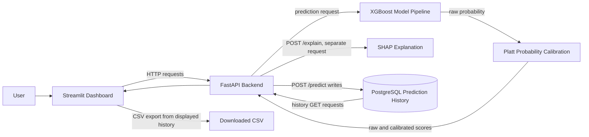
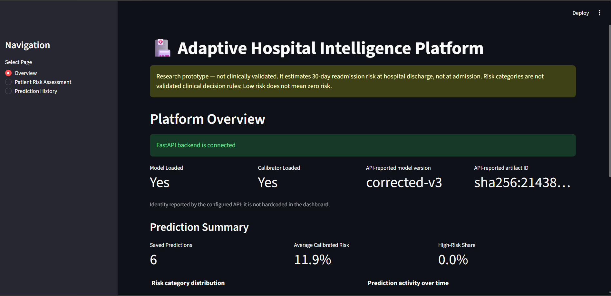
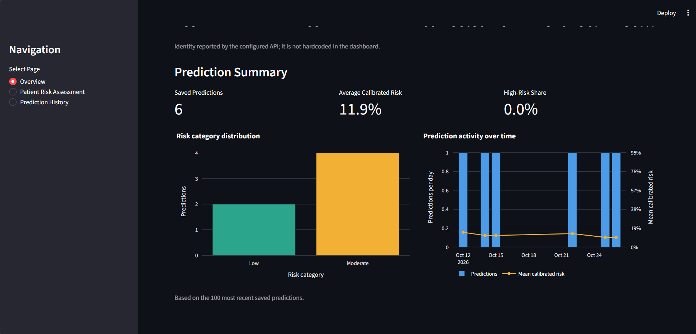
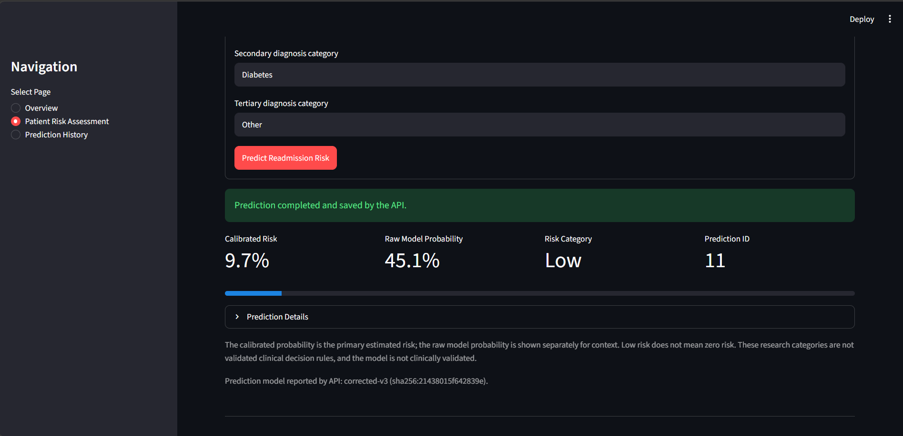
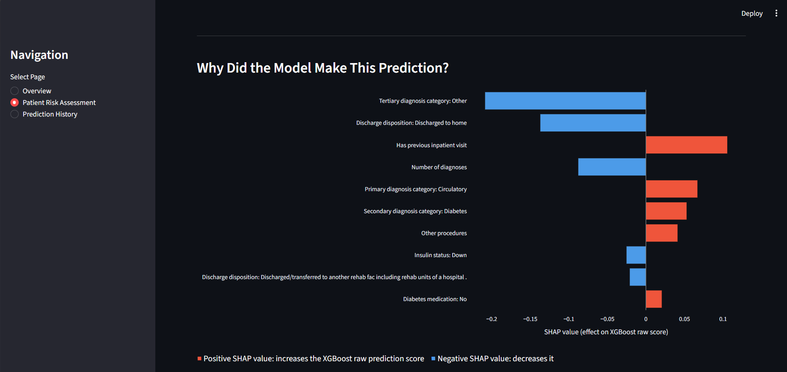
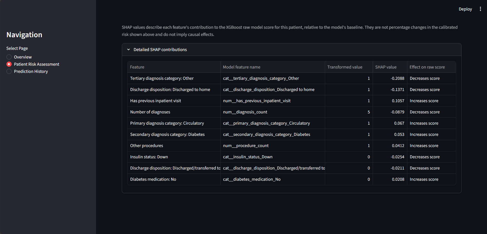
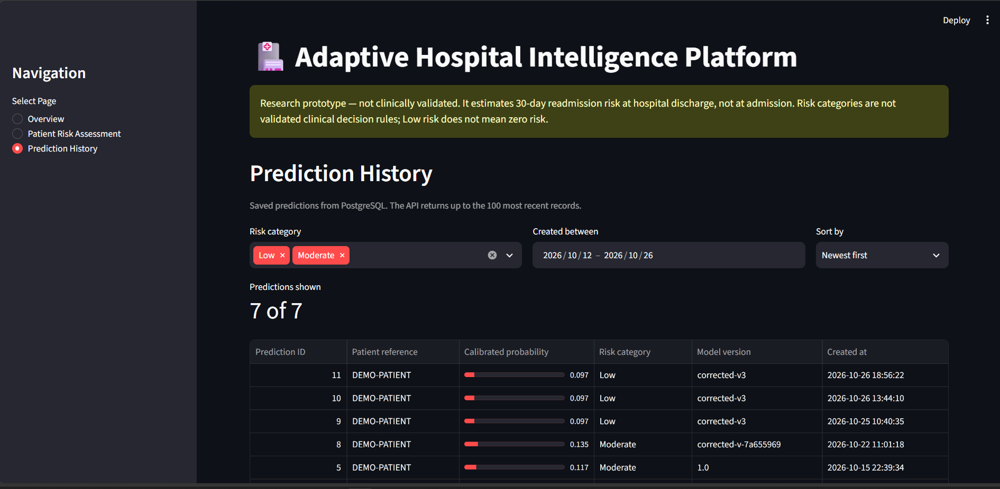

# Adaptive Hospital Intelligence Platform

**A deployed, end-to-end data science portfolio research prototype for estimating 30-day hospital readmission risk at discharge.**

[](https://adaptive-hospitalinteligence-platform-cqx99uqjrwebu2j9j7bpys.streamlit.app/)
[](https://adaptive-hospital-api.onrender.com/docs)
[](https://github.com/Noleenrue/Adaptive-Hospital_Inteligence-Platform)


> **Research prototype — not clinically validated.** This project estimates 30-day hospital readmission risk at discharge. It is not a medical device and must not be used to guide real patient care or other medical decisions.

## Contents

- [Project overview](#project-overview)
- [Live deployment](#live-deployment)
- [Technical architecture](#technical-architecture)
- [Implemented features](#implemented-features)
- [Model performance](#model-performance)
- [Technology stack](#technology-stack)
- [Dashboard screenshots](#dashboard-screenshots)
- [Local setup](#local-setup)
- [Limitations and responsible use](#limitations-and-responsible-use)
- [Documentation](#documentation)
- [Dataset attribution](#dataset-attribution)

## Project overview

The Adaptive Hospital Intelligence Platform demonstrates an end-to-end machine learning application: historical encounter data is used to estimate the probability of readmission within 30 days of hospital discharge, and the resulting service is exposed through a FastAPI backend and Streamlit dashboard. The project brings together model serving, probability calibration, explainability, persistent prediction history, and a user-facing interface in a deployable portfolio prototype.

The model is built around the UCI Diabetes 130-US Hospitals dataset. Its intended scoring point is **hospital discharge**, not admission; some input information is only available at or near discharge. The application is intended for demonstration and engineering evaluation, not clinical use.

## Live deployment

| Service | Hosting | Link |
|---|---|---|
| Streamlit dashboard | Streamlit Community Cloud | [Open the live application](https://adaptive-hospitalinteligence-platform-cqx99uqjrwebu2j9j7bpys.streamlit.app/) |
| FastAPI backend | Render | [Open the interactive API documentation](https://adaptive-hospital-api.onrender.com/docs) |
| Source code | GitHub | [View the repository](https://github.com/Noleenrue/Adaptive-Hospital_Inteligence-Platform) |

Prediction history is persisted by the API in PostgreSQL. The repository documentation describes `DB_HOST`, `DB_PORT`, `DB_NAME`, `DB_USER`, and `DB_PASSWORD` configuration, with local development defaults; it does not identify a hosted PostgreSQL provider. No database provider or connection details are assumed or published here.

## Technical architecture



For assessment, the dashboard sends input to FastAPI; the model pipeline produces a raw probability and the Platt calibrator produces the calibrated estimate. The API's separate explanation endpoint computes SHAP contributions for the input; these explain the model's raw margin and are not calibrated-probability percentage points. A successful `POST /predict` persists the prediction record to PostgreSQL, while history endpoints read saved records. CSV export is generated by the dashboard from history data. SHAP is not a database write step.

## Implemented features

- **Patient risk assessment:** Streamlit form submits encounter features to the prediction API.
- **Calibrated predictions:** XGBoost output is accompanied by a Platt-scaled probability and research risk tier.
- **SHAP explanations:** Separate explanation request provides feature contributions for the model's raw margin.
- **Prediction history:** PostgreSQL-backed records are retrieved through the API and presented in the dashboard.
- **PostgreSQL persistence:** Prediction submissions are stored; history retrieval is read-only.
- **CSV export:** Dashboard users can download the currently filtered prediction history.
- **API-backed dashboard:** FastAPI exposes health/model identity, prediction, explanation, and history endpoints.

## Model performance

Evaluation of the corrected-v3 model on a held-out, patient-disjoint test set:

| Metric | Result |
|---|---:|
| Test encounters | 20,075 |
| Unique test patients | 14,088 |
| ROC-AUC | 0.6656 |
| PR-AUC (Average Precision) | 0.2232 |
| Brier score | 0.0972 |
| Recall at threshold 0.15 | 0.4056 |
| Precision at threshold 0.15 | 0.2161 |

These figures describe performance on one historical test partition, not prospective clinical performance. See [the full evaluation report](reports/corrected_v3_model_evaluation_report.md) for confidence intervals, calibration details, and limitations.

## Technology stack

| Layer | Technologies |
|---|---|
| Programming | Python, pandas, NumPy |
| Machine learning | XGBoost, scikit-learn |
| Explainability | SHAP |
| Backend | FastAPI, Pydantic |
| Frontend | Streamlit |
| Database | PostgreSQL, psycopg2 |
| Testing | pytest |
| Version control | Git, GitHub |

## Dashboard screenshots

The following screenshots are present in [`docs/screenshots/`](docs/screenshots/):

| Dashboard view | Preview |
|---|---|
| Platform overview |  |
| Prediction analytics |  |
| Patient risk assessment |  |
| SHAP explanation |  |
| Detailed feature contributions |  |
| Prediction history |  |

## Explore the project

- [System architecture](docs/architecture.md)
- [Technical case study](docs/technical_case_study.md)
- [Model evaluation report](reports/corrected_v3_model_evaluation_report.md)
- [Interview demonstration guide](docs/interview_demo.md)
- [Portfolio presentation](docs/portfolio_presentation.md)

---

## Local setup

These instructions are for a local Windows development environment. They do not represent a hosted deployment.

### Prerequisites and repository caveats

- Python 3.11.3 is the version recorded in the corrected-v3 manifest and verified in the working project environment. `requirements.txt` pins direct dependencies to that environment; it is not a platform-specific lock file, so transitive dependency versions are resolved at installation.
- A local PostgreSQL server is needed for prediction persistence and history. The project provides `database/schema.sql`; database creation is a separate manual step and migrations are not implemented.
- Downloaded data, processed features, and model binaries are not included in a fresh clone. Follow the dataset and artifact steps below before running the API or evaluator.
- `.env.example` contains variable names and safe local placeholders only. Never commit `.env` or put real credentials in documentation.

### Install Python dependencies

From the repository root in PowerShell:

```powershell
py -3.11 -m venv .venv
.\.venv\Scripts\python.exe -m pip install --upgrade pip
.\.venv\Scripts\python.exe -m pip install -r requirements.txt
```

Using the virtual-environment interpreter directly avoids PowerShell activation-policy changes. For an existing `.venv`, do not recreate it; install only if you intentionally want to update that environment.

### Obtain the dataset

1. Download the dataset ZIP from the [official UCI dataset page](https://archive.ics.uci.edu/dataset/296/diabetes+130-us+hospitals+for+years+1999-2008).
2. Extract `diabetic_data.csv` and `IDS_mapping.csv` into `data\raw\`, creating the directory if needed:

   ```text
   data\raw\diabetic_data.csv
   data\raw\IDS_mapping.csv
   ```

3. UCI lists the dataset under [CC BY 4.0](https://creativecommons.org/licenses/by/4.0/). Retain attribution to Clore, Cios, DeShazo, and Strack (2014), follow the license terms, and check the official listing before redistribution. The dataset contains sensitive demographic attributes; do not publish patient-level extracts.

### Build and compare a processed-data candidate

The preprocessing command reads the already-downloaded UCI CSVs and uses the project adapter, UCI lookup loader, clinical preprocessor, and feature engineer. It writes only to a new `data\processed\candidates\<run-id>\` directory and refuses to overwrite an existing run:

```powershell
.\.venv\Scripts\python.exe scripts\preprocess_uci_data.py
```

Optional paths can be supplied with `--raw-data`, `--mapping-data`, and `--reference`. A custom `--run-id` may contain only letters, digits, dots, underscores, and hyphens. The command records input/output hashes, processing configuration, row and target counts, identifier-set digests, duplicate counts, and comparison results in `validation_report.json` and `validation_report.md`.

When the historical `data\processed\clinical_features.csv` is present, the command compares row counts, column order, CSV-inferred dtypes, target distribution, patient/encounter identifier sets, duplicate counts, and row values matched by encounter ID. It does not modify the reference. Expired-discharge rows are retained in the processed file to match the historical dataset; the corrected-v3 exporter excludes rows whose mapped discharge disposition contains `Expired` before splitting. Missing HbA1c and glucose remain missing in this processed table; the corrected-v3 model mapping is applied downstream.

An exact comparison demonstrates agreement with the local reference for these inputs. It does not prove that the raw files are byte-identical to the historical originals unless their historical hashes are independently available, nor does it guarantee a byte-identical model bundle. Review the report and discrepancies rather than changing transformations to force agreement.

**Verified local run (2026-10-26):** 101,766 rows, 29 columns, matching CSV-inferred dtypes, target distribution, patient/encounter identifier sets and duplicate counts, with zero row-value mismatches. The candidate CSV SHA-256 exactly matched the existing processed file: `66cd14a7d3d634e6182f63e78fd307bbbe9264c997de73439caf283b757cd28a`. The report records raw input hashes and reports 1,652 expired-discharge rows retained for the downstream corrected-v3 exporter to exclude. This verifies byte-for-byte agreement for the local inputs; it does not establish historical raw-file provenance or guarantee identical future model artifacts.

### Obtain or regenerate model artifacts safely

The FastAPI predictor expects a compatible bundle in `models\` containing:

```text
models\readmission_xgb_pipeline.joblib
models\platt_calibrator.joblib
models\manifest.json
```

These model binaries are intentionally ignored by Git and are not downloaded automatically. For the existing promoted corrected-v3 bundle, obtain the three files together from an approved, trusted project backup or transfer. Verify the model and calibrator SHA-256 values against the manifest before serving. The manifest records version `corrected-v3` and artifact ID `sha256:21438015f642839e`; check `GET /health` after starting the API to confirm what it loaded. Do not obtain model files from an untrusted source.

To create a **separate candidate** from a verified `data\processed\clinical_features.csv`, generate a unique candidate version:

```powershell
$version = "local-reproduction-$((Get-Date).ToUniversalTime().ToString('yyyyMMdd-HHmmss'))"
.\.venv\Scripts\python.exe scripts\export_model_bundle.py --version $version --lab-not-measured
```

The exporter writes under `models\candidates\<version>\` and refuses to overwrite an existing candidate. This generates a new candidate; it does not guarantee a byte-identical corrected-v3 artifact. Review its manifest and evaluate it independently. **Do not run `scripts\promote_candidate.py`** as part of setup: promotion changes the deployed bundle.

### Configure PostgreSQL

If the local database does not already exist, create it in pgAdmin or run the following command **once for a new database only**:

```powershell
createdb -h localhost -p 5432 -U postgres adaptive_hospital_db
```

Then initialize the table schema from the repository root:

```powershell
psql -h localhost -p 5432 -U postgres -d adaptive_hospital_db -v ON_ERROR_STOP=1 -f .\database\schema.sql
```

If the database already exists, skip `createdb`. The schema uses `CREATE TABLE IF NOT EXISTS`; it does not delete or update existing prediction rows. Confirm that `psql` is connected to the intended local database before running it. The connection reads `DB_HOST`, `DB_PORT`, `DB_NAME`, `DB_USER`, and `DB_PASSWORD` from environment variables or `.env`.

Create a local `.env` from the example only if one does not already exist; preserve existing local settings:

```powershell
if (-not (Test-Path .env)) { Copy-Item .env.example .env }
notepad .env
```

Replace the password placeholder locally. Do not paste, commit, or share `.env`. The connection defaults are `localhost`, `5432`, `adaptive_hospital_db`, and `postgres`. `API_URL` defaults to `http://127.0.0.1:8001`; `READMISSION_MODEL_DIR` may point to another verified compatible bundle, or be left blank to use `models\`.

### Start the API and dashboard

Run each command in a separate PowerShell window from the repository root:

```powershell
.\.venv\Scripts\python.exe -m uvicorn api.main:app --host 127.0.0.1 --port 8001
```

```powershell
.\.venv\Scripts\python.exe -m streamlit run dashboard/app.py --server.port 8502
```

Open `http://127.0.0.1:8502`. The dashboard's default API URL is `http://127.0.0.1:8001`; set `API_URL` to override it. The API loads the default model bundle from `models/`. Check `/health` for the API-reported model and artifact identity.

**Persistence warning:** `POST /predict` writes a prediction record to PostgreSQL. `POST /explain` and history GET routes do not create prediction records. Use synthetic data only for demonstrations.

### Run focused tests without database writes

From the repository root:

```powershell
.\.venv\Scripts\python.exe -m pytest -q tests/test_dashboard_api_client.py tests/test_dashboard_explanation.py tests/test_dashboard_history.py tests/test_evaluate_corrected_v3.py
```

These focused tests use mocked dashboard/API calls or read-only local evaluation inputs. Do not run the full suite against a shared or production database: `tests/test_repository.py` inserts a test prediction and later deletes it, while `tests/test_database_connection.py` connects to the configured database. See [the interview demo](docs/interview_demo.md) for a low-risk walkthrough and persistence details.

## Limitations and responsible use

- Predictions are intended **at hospital discharge**, not at admission. Discharge disposition, length of stay, final diagnoses, and completed-encounter information may not be available earlier.
- This is a research prototype and **not clinically validated**. Risk categories are not validated decision rules; Low risk is not zero risk.
- The evaluation is a patient-disjoint random split from a single historical dataset, not temporal, hospital-held-out, or external validation.
- No prospective utility, fairness, causal effects, or patient outcome improvements have been established.
- SHAP contributions explain the XGBoost **raw margin** (log-odds), not calibrated probability percentage points; they are not causal explanations.
- Prediction submissions are stored in PostgreSQL. The dashboard's submission lock is UI-only and does not guarantee exactly-once writes.

## Documentation

- [Technical case study](docs/technical_case_study.md)
- [System architecture](docs/architecture.md)
- [5–10 minute interview demo](docs/interview_demo.md)
- [Portfolio presentation outline](docs/portfolio_presentation.md)
- [Corrected-v3 evaluation report](reports/corrected_v3_model_evaluation_report.md)
- [Historical corrected-v2 evaluation report](reports/model_evaluation_report.md) — retained for provenance; not the source of current v3 metrics.

## Dataset attribution

The source is the [UCI Diabetes 130-US Hospitals for Years 1999–2008 dataset](https://doi.org/10.24432/C5230J), licensed by UCI under [CC BY 4.0](https://creativecommons.org/licenses/by/4.0/). Attribute the dataset to Clore, Cios, DeShazo, and Strack (2014), *Diabetes 130-US Hospitals for Years 1999–2008*, UCI Machine Learning Repository. See the [official UCI dataset page](https://archive.ics.uci.edu/dataset/296/diabetes+130-us+hospitals+for+years+1999-2008) for citation and license details. The associated paper is Strack et al. (2014), “Impact of HbA1c Measurement on Hospital Readmission Rates: Analysis of 70,000 Clinical Database Patient Records,” *BioMed Research International*, 2014, Article 781670, https://doi.org/10.1155/2014/781670.
