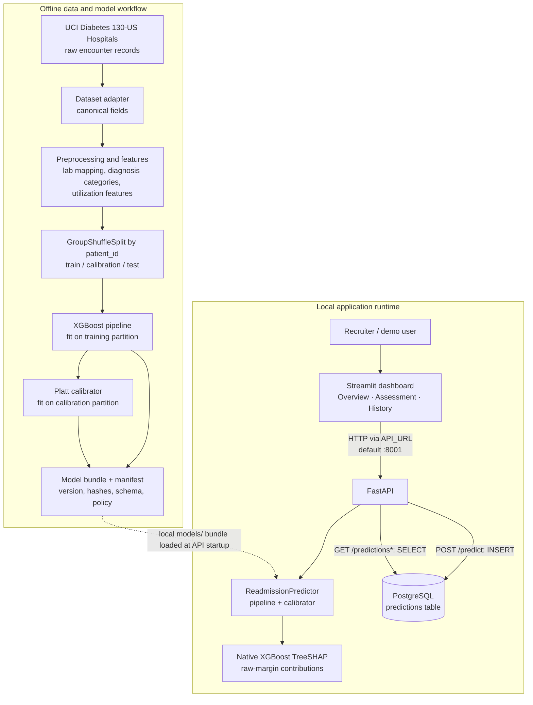

# System Architecture

> **Research prototype — not clinically validated.** Predictions estimate 30-day readmission risk **at hospital discharge**, not at admission. The risk tiers are not validated clinical decision rules.

## Component diagram

## Components and responsibilities

| Component | Responsibility | Relevant files |
|---|---|---|
| Dataset adapter | Reads the source dataset and maps source columns into project fields. | `src/adapters/` |
| Preprocessing and feature engineering | Creates model inputs, including diagnosis categories, utilization features, and explicit unmeasured lab categories. | `src/preprocessing/`, `src/features/` |
| Training/export workflow | Builds a patient-grouped train/calibration/test split, fits preprocessing and XGBoost on training data, and Platt calibration on a separate calibration partition. | `scripts/export_model_bundle.py`, `notebooks/` |
| Artifact manifest | Identifies model version, hashes, feature schema, data/split provenance, mapping, and risk-policy values. | `models/manifest.json` |
| Predictor | Loads the pipeline and calibrator, validates artifact metadata, applies the input mapping, predicts raw probability, calibrates it, and assigns a tier. | `src/models/predictor.py`, `src/models/risk_policy.py` |
| FastAPI service | Exposes model health, prediction, explanation, and history routes. | `api/main.py`, `api/schemas.py` |
| SHAP explainer | Uses native XGBoost contributions for the exact transformed pipeline input and checks reconstruction of the raw margin. | `src/explainability/shap_explainer.py` |
| PostgreSQL repository | Inserts prediction records and reads history from the `predictions` table. | `database/repository.py`, `database/schema.sql`, `database/connection.py` |
| Streamlit dashboard | Shows model identity, estimates, SHAP explanations, and persisted history. | `dashboard/app.py`, `dashboard/api_client.py` |

## Runtime data flow

1. The user enters synthetic demonstration features in the Streamlit Assessment page.
2. The dashboard validates inputs locally and sends requests to FastAPI using `API_URL` (default `http://127.0.0.1:8001`).
3. FastAPI validates the request using Pydantic schemas and calls the loaded `ReadmissionPredictor`.
4. The predictor applies the model-declared lab input mapping, executes the XGBoost pipeline, and applies the Platt calibrator. Raw and calibrated probabilities remain separate.
5. `POST /predict` saves the returned scores, risk tier, and model identity to PostgreSQL. This route performs a persistent INSERT.
6. `POST /explain` computes a SHAP explanation for the same predictor input and reports raw-score contributions; it does not persist a prediction.
7. The dashboard's Overview obtains model version/artifact identity from `GET /health`. Prediction History uses GET routes and is read-only.

The dashboard's submission lock is a client-side repeat-submission deterrent only. It does not make the prediction write exactly-once.

## Model and evaluation flow

The corrected-v3 artifact is `corrected-v3` with ID `sha256:21438015f642839e`. The evaluation report verifies the manifest, data hash, death-related discharge filter, deterministic seed, partition sizes, and patient disjointness before scoring the held-out test partition. The test set does not fit the model or calibrator.

The intended scoring point is **at hospital discharge**. Discharge disposition, length of stay, final diagnoses, and completed encounter details are not generally available at admission; an admission-time use would violate the documented feature-availability contract.

## Operational boundaries

- PostgreSQL is used for persisted prediction history, not model training.
- `POST /predict` writes; `POST /explain` and history GET requests do not.
- The API loads local model artifacts; no cloud or container deployment is implemented or claimed.
- The dashboard's URL can be configured with `API_URL`; do not silently switch to an unverified API service.
- The entire system is a research portfolio prototype and is not clinically validated.
