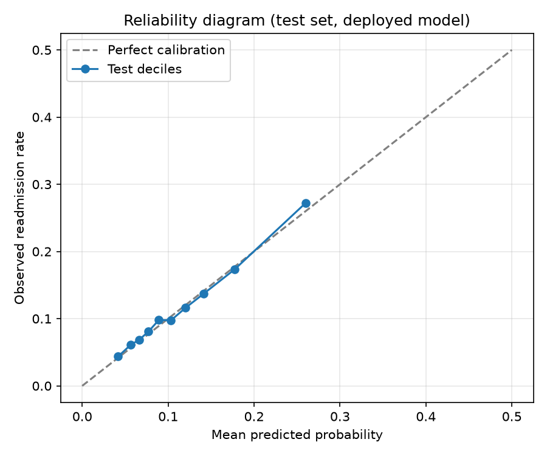
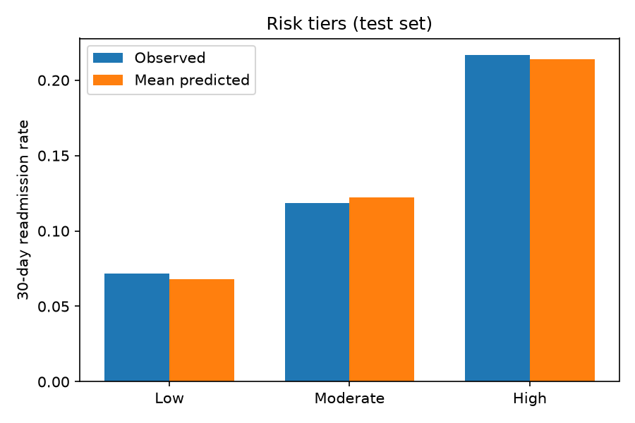
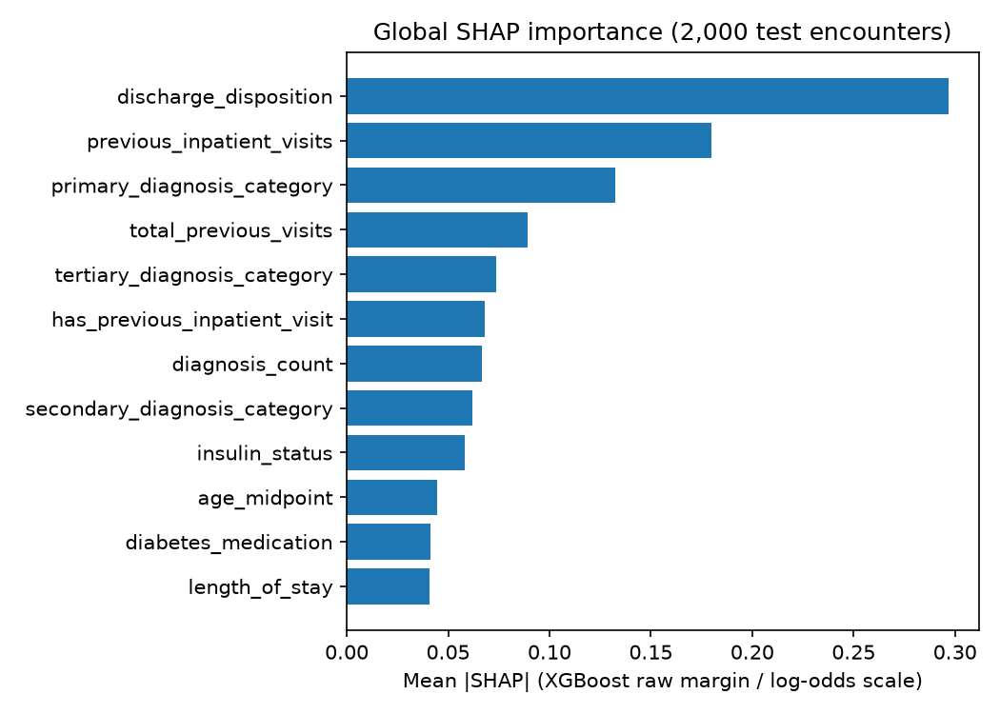

# Model Evaluation Report — 30-Day Diabetic Readmission Risk Model

**Project:** Adaptive Hospital Intelligence Platform
**Model version:** `corrected-v2-candidate` (deployed) · **Artifact ID:** `sha256:7a6559690e92db87`
**Evaluation date:** 2026-10-22
**Status:** Research prototype. Not clinically validated.

All figures in this report come from `src/evaluation/evaluate_model.py`, a read-only script that loads the deployed artifacts and scores the untouched patient-level test partition. Raw outputs are in this folder (`evaluation_metrics.json` and `evaluation_*.csv`). No model was trained or tuned, and no threshold was changed, to produce this report. Results from the superseded unfiltered model (notebooks 03/04, `readmission_xgboost_v1.joblib`) are **not** used anywhere in this report.

Items marked **pending** have not been measured.

---

## 1. Executive Summary

The deployed model estimates the probability that a diabetic inpatient is readmitted within 30 days of discharge. It is an XGBoost classifier followed by Platt calibration, converted into three risk tiers.

**Headline results (test set: 20,075 encounters, 14,088 patients, 11.48% readmitted):**

| Metric | Value (95% patient-level bootstrap CI) |
|---|---|
| ROC-AUC | 0.6655 (0.6509–0.6808) |
| PR-AUC (prevalence 0.1148) | 0.2230 (0.2039–0.2465) |
| Brier score | 0.0971 (0.0938–0.1004) |
| Log loss | 0.3374 (0.3285–0.3464) |
| Expected calibration error (10 equal-width bins) | 0.0048 (0.0026–0.0098) |
| At threshold 0.15: precision / recall / F1 | 0.2169 / 0.4074 / 0.2830 |

**Interpretation**
- **Calibration is good.** The mean predicted risk is 0.1133 against an observed rate of 0.1148, and the calibration slope is 1.006.
- **Discrimination is modest.** ROC-AUC 0.67 means the model ranks risk usefully but cannot predict individual readmissions reliably.
- **The tiers separate risk.** Observed readmission is 7.2% (Low), 11.8% (Moderate) and 21.7% (High), so High-tier patients are 3.0 times as likely to be readmitted as Low-tier patients.
- **Operating point.** At 0.15, 21.6% of encounters are flagged, 40.7% of readmissions are caught, and about 78% of flagged patients are not readmitted.

**Outstanding concerns (details in Sections 8–10):**
1. **`/explain` fidelity — fixed in code (2026-10-22).** The explainer previously did not reproduce the model's own score. It now uses native TreeSHAP on the exact pipeline input and is verified to reconstruct the deployed margin (Section 8).
2. **Train/serve skew in HbA1c and glucose — fixed in a new candidate, not yet deployed.** The deployed model still has it. The `corrected-v3` candidate encodes "not measured" explicitly and consistently, and awaits approval (Section 9).
3. **Discharge disposition drives the model.** It is the largest single feature group, and hospice discharges remain in the data.
4. **Single-source data with no external validation.**

---

## 2. Dataset Description

| Item | Value |
|---|---|
| Source | Public "Diabetes 130-US hospitals" dataset (`data/raw/diabetic_data.csv`, plus `IDS_mapping.csv`) |
| Raw encounters | 101,766 |
| Processed file | `data/processed/clinical_features.csv` (29 columns), SHA-256 `66cd14a7…d28a` |
| Eligible encounters (after exclusions) | 100,114 |
| Eligible patients | 70,439 (16,483, or 23.4%, have more than one encounter; maximum 40) |
| Target | `readmitted_30_days`, which is true when the source `readmitted` field equals `<30` |
| Eligible readmission rate | 11,357 of 100,114 (11.34%) |
| Duplicate encounter IDs | 0 |

The data come from one public source. Its publishers document it as covering 130 US hospitals over 1999–2008. This was taken from the public dataset documentation and not re-verified in this project.

**Model inputs (23 features):** demographics (age midpoint, gender, race); admission context (admission type and source, discharge disposition); utilisation (length of stay, prior inpatient, outpatient and emergency visits, total prior visits, prior-inpatient flag); encounter content (diagnosis, lab-procedure, procedure and medication counts, HbA1c result, glucose result, insulin status, diabetes medication); and three diagnosis categories (primary, secondary, tertiary).

---

## 3. Data Cleaning and Preprocessing

**Cleaning (upstream, `src/adapters`, `src/preprocessing`, `src/features`):**
- Source fields are mapped to a clinical schema (for example `time_in_hospital` becomes `length_of_stay`, and `number_inpatient` becomes `previous_inpatient_visits`).
- Age bands become a numeric midpoint.
- ICD diagnosis codes are grouped into categories.
- Two features are engineered: `total_previous_visits` and `has_previous_inpatient_visit`.

**Exclusion of death-related encounters (`evaluation_partitions.csv`):**
- 1,652 encounters whose discharge disposition contains "Expired" are removed *before* any split:

| Discharge disposition | Encounters |
|---|---|
| Expired | 1,642 |
| Expired at home. Medicaid only, hospice. | 8 |
| Expired in a medical facility. Medicaid only, hospice. | 2 |

- None of the 1,652 is labelled as a readmission (0.0%). Patients who die at discharge cannot be readmitted, so keeping them would teach the model a trivial and clinically meaningless pattern.
- The script confirms that no "Expired" discharge remains in any partition.

**Model-side preprocessing (fitted on the model-training partition only):**
- Numeric and boolean columns (11) get a median imputer.
- Categorical columns (12) get a most-frequent imputer, then one-hot encoding that ignores unknown categories.
- The output has 136 transformed features.

**Missing and placeholder values in the eligible data (`evaluation_feature_quality.csv`):**

| Feature | Missing / placeholder |
|---|---|
| `hba1c_result` | 83,238 missing (83.1%) = "not measured" |
| `glucose_result` | 94,890 missing (94.8%) = "not measured" |
| `race` | 2,239 missing (2.2%) |
| `admission_type` | 5,010 placeholder (not available / not mapped) |
| `discharge_disposition` | 989 placeholder |
| `admission_source` | 284 placeholder |
| `gender` | 3 "Unknown/Invalid" |

See Section 9, item 4, for how "not measured" is handled.

---

## 4. Model Development

| Item | Value |
|---|---|
| Pipeline | `Pipeline[preprocessor → classifier]` (step names are relied on by the SHAP explainer) |
| Classifier | XGBoost, `n_estimators` 400, `max_depth` 3, `learning_rate` 0.05, `subsample` 0.8, `colsample_bytree` 0.8, `random_state` 42 |
| Class weighting | `scale_pos_weight` = 7.8633 (negative to positive ratio in the training partition) |
| Configuration choice | "Shallow" was selected in notebook 03 from three configurations on a validation partition; their ROC-AUCs differed by at most 0.0014 |
| Libraries | Python 3.11.3, scikit-learn 1.9.1, xgboost 3.2.0 |

**Patient-level partitions** (`GroupShuffleSplit` on `patient_id`, seed 42, applied twice):

| Partition | Encounters | Patients | Readmitted | Rate | Role |
|---|---|---|---|---|---|
| Model training | 63,949 | 45,080 | 7,215 | 11.28% | Fit the XGBoost model |
| Calibration | 16,090 | 11,271 | 1,837 | 11.42% | Fit the Platt calibrator and select thresholds |
| Test | 20,075 | 14,088 | 2,305 | 11.48% | Final evaluation only |

The partitions were rebuilt independently from the data. They match the sizes stored in the deployed manifest, and the metrics recomputed from scratch equal the manifest's stored values to 1e-9.

---

## 5. Probability Calibration

- **Method:** Platt scaling, a one-variable logistic regression of the outcome on the raw XGBoost score. It was fitted on the calibration partition only (coefficient 4.3859, intercept −4.2058).
- **Why it is needed:** `scale_pos_weight` inflates the raw scores, which are not probabilities.

| Test set | Raw score | Platt calibrated |
|---|---|---|
| Brier score | 0.2209 | **0.0971** |
| Log loss | 0.6332 | **0.3374** |
| ECE | 0.3431 | **0.0048** |
| ROC-AUC | 0.6655 | 0.6655 |
| PR-AUC | 0.2230 | 0.2230 |

Platt scaling is monotonic, so discrimination is unchanged. Only the probability scale improves.

**Test-set reliability:**
- The calibration slope is 1.006 and the intercept is 0.027 (logit scale). A slope near 1 and an intercept near 0 indicate good calibration.
- Predicted and observed rates agree within 0.012 in every decile. Nine of ten deciles are within 0.009, and the largest gap is in the highest-risk decile (predicted 0.2598, observed 0.2719).
- The highest-risk bins are less well calibrated. For predictions of 0.3–0.4 (361 encounters) the model predicts 0.332 and the observed rate is 0.388. For 0.4–0.5 (only 27 encounters) it predicts 0.417 and the observed rate is 0.593.
- The reliability plot is in `figure_reliability_diagram.png`.

---

## 6. Model Performance

Test set: 20,075 encounters, evaluated once. Calibrated probabilities and the pre-fixed threshold **0.15** (selected on the calibration set in notebook 06) are used.

**Threshold-independent metrics** (see Section 1 for confidence intervals): ROC-AUC 0.6655, PR-AUC 0.2230, Brier 0.0971, log loss 0.3374, ECE 0.0048.

**Confusion matrix at 0.15** (`evaluation_confusion_matrix.csv`):

| | Predicted below 0.15 | Predicted at or above 0.15 |
|---|---|---|
| **Actually not readmitted** (17,770) | 14,379 (TN) | 3,391 (FP) |
| **Actually readmitted** (2,305) | 1,366 (FN) | 939 (TP) |

| Metric | Value |
|---|---|
| Precision (PPV) | 0.2169 |
| Recall (sensitivity) | 0.4074 |
| Specificity | 0.8092 |
| F1-score | 0.2830 |
| Negative predictive value | 0.9132 |
| Accuracy | 0.7630 |
| Flagged encounters | 4,330 (21.57%) |
| Lift (PPV ÷ prevalence) | 1.89 |

Accuracy is not a useful summary here, because predicting "no readmission" for everyone would score 88.5%. Read the PR-AUC against the 0.1148 prevalence baseline: 0.2230 is about 1.9 times that.

**Subgroup performance** (`evaluation_subgroups.csv`; groups under 200 encounters are not scored for AUC and are marked pending in the file):

| Group | Encounters | Observed rate | Mean predicted | ROC-AUC | Recall at 0.15 |
|---|---|---|---|---|---|
| Female | 10,657 | 0.1113 | 0.1152 | 0.663 | 0.403 |
| Male | 9,417 | 0.1188 | 0.1111 | 0.669 | 0.412 |
| Caucasian | 15,011 | 0.1185 | 0.1142 | 0.665 | 0.406 |
| African American | 3,814 | 0.1088 | 0.1147 | 0.664 | 0.441 |
| Hispanic | 387 | 0.0775 | 0.1028 | 0.655 | 0.233 |
| Other | 313 | 0.0958 | 0.0968 | 0.633 | 0.233 |
| Age <40 | 1,184 | 0.1115 | 0.0978 | 0.744 | 0.455 |
| Age 40–59 | 5,441 | 0.1007 | 0.1016 | 0.693 | 0.403 |
| Age 60–79 | 9,659 | 0.1206 | 0.1163 | 0.650 | 0.403 |
| Age 80+ | 3,791 | 0.1213 | 0.1274 | 0.624 | 0.411 |

- Overall calibration is consistent across gender, the largest race groups, and age, with gaps within about ±0.014.
- Discrimination falls with age (0.744 for under 40 to 0.624 for 80 and over). The flagged rate rises with age (17.3% at 40–59, 26.9% at 80+).
- The Hispanic and Other groups are small (30 readmissions each), so their results are too uncertain to conclude anything. Asian (134 encounters, 13 readmissions) is not scored for AUC.
- Subgroup fairness thresholds and formal fairness testing are **pending**.

---

## 7. Risk Stratification

Tiers are fixed by `src/models/risk_policy.py` and match notebook 06 and the deployed manifest: **Low** below 0.10, **Moderate** from 0.10 to below 0.15, **High** at or above 0.15 (the intervention threshold). Thresholds were not changed in this evaluation.

| Tier | Encounters | Share | Readmitted | Observed rate | Mean predicted | Relative risk vs Low |
|---|---|---|---|---|---|---|
| Low | 10,630 | 52.95% | 761 | 0.0716 | 0.0679 | 1.00 |
| Moderate | 5,115 | 25.48% | 605 | 0.1183 | 0.1224 | 1.65 |
| High | 4,330 | 21.57% | 939 | 0.2169 | 0.2138 | 3.03 |
| **All** | **20,075** | 100% | 2,305 | 0.1148 | 0.1133 | — |

- Within each tier, predicted and observed rates agree within 0.005 (Low 0.0679 vs 0.0716, Moderate 0.1224 vs 0.1183, High 0.2138 vs 0.2169).
- The High tier holds 21.6% of encounters but 40.7% of all readmissions.
- The Low tier is not risk-free: 761 readmissions (33% of the total) occur there.
- The 0.15 threshold is a prototype choice made from calibration-set precision/recall trade-offs. It is not tuned to any hospital's capacity or intervention cost, which remains **pending**.

---

## 8. Explainability

**How SHAP is used.** `src/explainability/shap_explainer.py` computes exact TreeSHAP contributions from the deployed XGBoost booster, on the matrix the pipeline itself feeds to `predict`. The API's `POST /explain` returns the ten largest contributions per patient, with each transformed feature name, its value and its SHAP value, plus the base value, the raw margin and the model version and artifact ID. The dashboard presents these as the drivers of the prediction.

**Output scale.** SHAP values are in the **raw XGBoost margin (log-odds) scale**, before sigmoid and before Platt calibration. They are not percentage points of the final probability. The calibrated probability is a monotonic transform of the sum of the margin and its contributions.

**Verified correspondence to the corrected model:**
- The explainer holds the same classifier and preprocessor objects as the deployed predictor, loaded from the corrected artifact bundle (`sha256:7a6559690e92db87`).
- XGBoost's native SHAP contributions, computed on the pipeline's own input, sum to the deployed raw margin with a maximum error of 1.3e-6 across 2,000 test encounters.
- Notebook 04 does **not** correspond to the corrected model. It loads `readmission_xgboost_v1.joblib`, the older unfiltered model. Its SHAP figures should not be cited, and it should be re-run on the corrected model.

**Faithful global importance** (corrected model, native SHAP, 2,000 randomly drawn test encounters, `evaluation_shap_by_original_feature.csv`). Shares are each feature's share of summed mean |SHAP|; one-hot columns are summed per source feature.

| Feature | Share | Mean \|SHAP\| (log-odds) |
|---|---|---|
| Discharge disposition | 22.0% | 0.297 |
| Previous inpatient visits | 13.3% | 0.180 |
| Primary diagnosis category | 9.8% | 0.132 |
| Total previous visits | 6.6% | 0.089 |
| Tertiary diagnosis category | 5.5% | 0.074 |
| Has previous inpatient visit | 5.0% | 0.068 |
| Diagnosis count | 4.9% | 0.067 |
| Secondary diagnosis category | 4.6% | 0.062 |
| Insulin status | 4.3% | 0.058 |
| Age midpoint | 3.3% | 0.044 |

Prior inpatient visits appear in three correlated features (previous inpatient visits, total previous visits, has-previous-inpatient flag), together about 25% of the importance.

**Resolved limitation: `/explain` previously did not explain the deployed prediction (fixed 2026-10-22).**
- XGBoost treats entries absent from a sparse matrix as *missing*. The pipeline predicts from the sparse preprocessor output.
- The earlier `ReadmissionSHAPExplainer` converted that matrix to a dense array first, which turned absences into real zeros, so it explained a different function from the one that produced the prediction.
- Pre-fix measurement on 2,000 test encounters: the dense margin differed from the deployed margin by more than 0.1 in 99.75% of cases (mean gap 2.43, maximum 4.82 log-odds); the sigmoid of that margin differed from the deployed raw probability by up to 0.83; top-10 feature overlap with the faithful values was 3.4% and the top feature differed in 99.4% of encounters. This predates the corrected model.
- Fix: contributions now come from the booster's native `pred_contribs` on the pipeline's own sparse output and are checked against the deployed margin on every call.
- Post-fix verification (`evaluation_metrics.json`, `shap.explain_endpoint_fidelity`): over 200 test encounters, contributions plus base value reconstruct the deployed margin, and equal the batch native SHAP. The automated tests in `tests/test_explanation_fidelity.py` cover reconstruction, feature-name order, value alignment and agreement with `predict`.
- Details, including the before/after comparison, are in [shap_and_lab_encoding_fix.md](shap_and_lab_encoding_fix.md).

**Other SHAP limitations:**
- SHAP describes the model, not causation. A contribution says how the model uses a feature, not that changing it would change the outcome.
- Correlated features share credit unpredictably.
- One-hot columns are explained separately, so a patient's absent categories can appear as drivers.
- SHAP says nothing about uncertainty or about patients unlike the training data.

---

## 9. Data Leakage and Reliability Checks

**Checks that passed (17 of 17, run automatically):**
- The data file hash, eligible and excluded counts, and all three partition sizes equal the deployed manifest.
- Train, calibration and test patient sets are pairwise disjoint, and no encounter appears in two partitions.
- No "Expired" discharge remains in any partition.
- The model's feature order and the risk thresholds equal the manifest.
- Recomputed ROC-AUC, PR-AUC, Brier score and log loss equal the manifest values to 1e-9.
- The SHAP explainer uses the deployed classifier and preprocessor, and native SHAP contributions reproduce the deployed margin.

**Feature availability at the intended prediction time.**
- The intended prediction time is **at discharge**. All 23 inputs come from the index encounter record or from prior-year utilisation counts, which the dataset documentation describes as visits in the year before the encounter.
- The label, `patient_id` and `encounter_id` are not model features.
- The features most dependent on late-finalised data are the diagnosis categories (final coding can lag discharge) and discharge disposition (known only at discharge). These are acceptable for a discharge-time model but would be unavailable for a prediction made at admission.

**Remaining concerns:**

1. **Soft selection leakage (minor).** The configuration choice and earlier design decisions (notebooks 02–03) were made on the older partitions. Of the 14,088 corrected-test patients, 2,205 (15.7%) were in the older validation partition used to choose among three configurations. Those configurations differed by at most 0.0014 ROC-AUC. The calibrator and thresholds used only the corrected calibration partition. No corrected-test data was used to fit, calibrate or select thresholds.
2. **Discharge disposition dominates.** It supplies 22% of importance. 771 hospice discharges remain eligible (138 in the test set); their readmission rate is 5.6% against 11.4% for all other discharges. Hospice is a proxy for terminal illness, not a death exclusion, so a sensitivity analysis excluding hospice is **pending**.
3. **Repeat patients.** 23.4% of patients have several encounters. Patient-level splitting handles leakage, and the confidence intervals above resample whole patients. Treating encounters as independent would understate uncertainty.
4. **Train/serve skew for HbA1c and glucose (open for the deployed model; fixed in candidate `corrected-v3`).**
   - In the training data, "not measured" was a missing value, and the imputer replaced it with the most frequent measured result (`>8` for HbA1c, `Norm` for glucose), so the deployed model read an unmeasured result as a measured one.
   - The dashboard and API send the literal string "None". The deployed encoder has never seen it, so it becomes an all-zero encoding, which differs from training.
   - "Not measured" covers 83% (HbA1c) and 95% (glucose) of rows. Measured on the 20,075 test encounters (`candidate_corrected-v3_comparison.json`): scoring blanks as in training versus "None" as served changes the calibrated probability by 0.0046 on average (maximum 0.061) and moves 5.5% of encounters to a different risk tier.
   - Candidate `corrected-v3` adds an explicit "Not measured" category, applied identically in training and serving. Its skew is exactly 0, and its test metrics are essentially unchanged (ROC-AUC 0.6656 vs 0.6655; Brier 0.0972 vs 0.0971). It has not been promoted.
5. **Class imbalance (11.3% positive).** It was handled with `scale_pos_weight` and then repaired by calibration. Precision remains low (0.217) at any operating point with useful recall.
6. **Generalisability.**
   - It is one dataset from one period, with no dates or hospital identifiers. Temporal, hospital-level and external validation are all **pending**.
   - It covers older coding practice (ICD-9), and readmissions to other hospitals are not observed.
   - Unmapped or unusual admission types ("Newborn", "Trauma Center", "Unmapped:6") appear in a few rows.
7. **Provenance housekeeping.** The deployed `models/manifest.json` still reads `"status": "candidate - not promoted"`. It is left unmodified so its hash matches the verified candidate. The actual promotion record is in `models/backups/20261019-174834/backup_record.json`.

---

## 10. Limitations and Ethical Considerations

- **Intended use.** Decision support for prioritising post-discharge follow-up, not diagnosis or treatment. A clinician must make the final decision.
- **Modest discrimination.** ROC-AUC 0.67 and precision 0.22 mean most flagged patients are not readmitted, and 59% of readmissions are missed at 0.15. Low-tier patients still account for a third of readmissions, so "Low" must not be read as "safe".
- **Calibration may drift.** It was checked on one held-out sample from the same distribution. It needs monitoring after deployment.
- **Use of protected attributes.** Race, gender and age are model inputs. Subgroup calibration looks consistent for the large groups, but smaller groups (Hispanic, Other, Asian) cannot be assessed reliably. Whether race should be an input is an open question for the clinical and ethics reviewers.
- **Bias in the outcome.** Readmission depends on access to care and on follow-up practice, so it reflects system behaviour as well as health. Using it as a proxy for need can reproduce existing disparities.
- **Data protection.** The development dataset is a de-identified public dataset. Live use would involve identifiable patient data and needs governance, access control and audit logging. The API currently stores a fixed `DEMO-PATIENT` reference.
- **Explanations.** SHAP explanations are now faithful to the deployed model's raw score (Section 8). They remain descriptions of model behaviour, not causes, and they are on the log-odds scale, so users should not read them as probability changes.

---

## 11. Conclusion and Recommendations

**Conclusion.** The deployed corrected model is correctly tied to its evaluation split. Patient-level separation holds, death-related encounters are excluded, and the manifest metrics reproduce exactly. It is well calibrated and its risk tiers rank patients meaningfully (7.2% / 11.8% / 21.7% observed). Its discrimination is modest (ROC-AUC 0.67), which is typical for this dataset. It is suitable as a prototype, not for clinical use.

**Recommended next steps, in priority order:**
1. ~~Fix `/explain`~~ **Done (2026-10-22):** native TreeSHAP on the pipeline's sparse input, with tests asserting contributions sum to the deployed margin.
2. **Promote `corrected-v3`** (explicit "Not measured" encoding in training and serving, retrained and recalibrated on the same patient split) after approval, using `scripts/promote_candidate.py`. Until then the deployed model keeps the HbA1c/glucose skew.
3. **Re-run notebook 04** on the corrected model, or clearly mark its results as superseded.
4. **Run a hospice sensitivity analysis** and review the dominance of discharge disposition.
5. **Confirm the intervention capacity and costs** before treating 0.15 as an operating point, and add decision-curve or net-benefit analysis (pending).
6. **Seek external or temporal validation** and formal subgroup fairness review (pending).
7. **Record provenance properly** by updating the manifest status at promotion in a way that preserves hash verification, and monitor calibration drift after go-live.

**Reproducibility.** Run `python -m src.evaluation.evaluate_model` from the project root. It regenerates `evaluation_metrics.json`, the `evaluation_*.csv` tables and the three figures here, without modifying models, data or the database.
